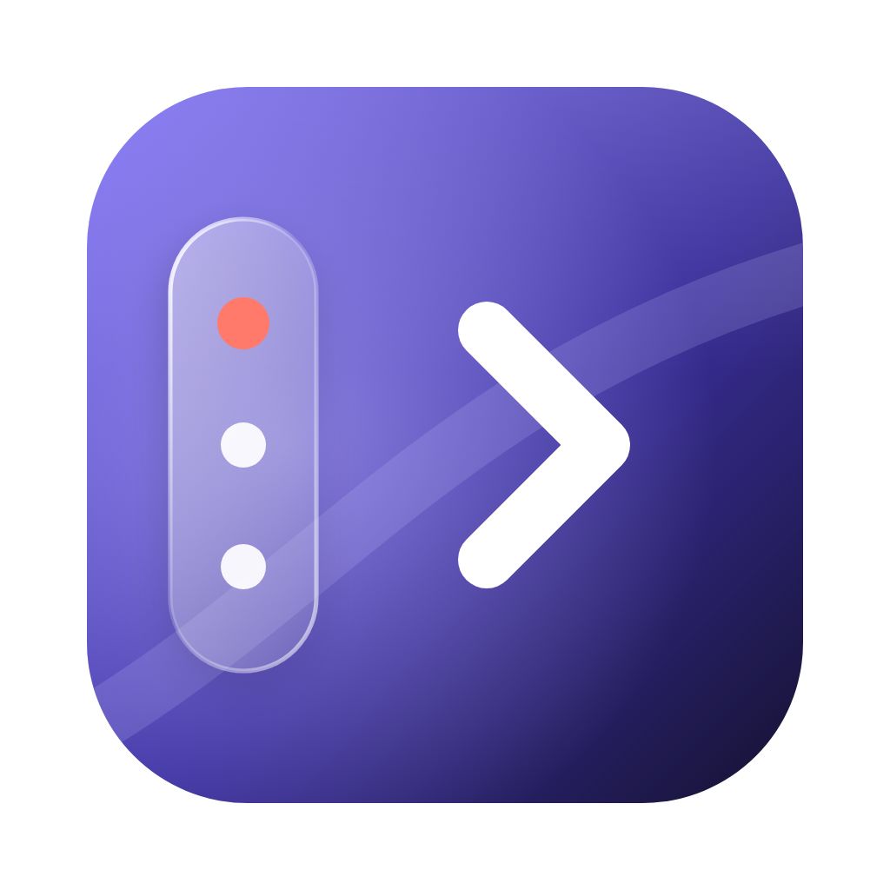

<p align="center">
  
</p>

<h1 align="center">Ledge</h1>

<p align="center">
  A small floating dock for the edge of your screen: mic and speaker mute, media keys, a Google Meet camera switch,
  on-screen pen, Bluetooth batteries, and clipboard and file sharing between your own computers over Tailscale.
</p>

<p align="center">
  <a href="https://github.com/Amirnajafi/ledge/releases/latest"></a>
  
  
  <a href="LICENSE"></a>
</p>

---

Ledge sits on any edge of any screen. Collapsed, it's a thin tab. Click it and a row of tools slides out.
Drag the grip to move the dock to another edge or another monitor; it snaps to the nearest edge and remembers where you left it.

## Features

| Tool | Click | Right-click |
|---|---|---|
| **Microphone** | Mute or unmute the default input | Pick the input device, star a favourite |
| **Speaker** | Mute or unmute the default output | Pick the output device, star a favourite |
| **Pen** | Draw on top of everything (right-click undoes a stroke) | Colour, width, highlighter |
| **Bluetooth** | Battery level of every connected accessory, lowest first | — |
| **Media** | Play / pause | Previous / next |
| **Meet camera** | Turn your camera on or off in the Google Meet call, wherever its tab is | Camera mirror |
| **Clipboard** | Copied text appears on your other computers | Sync on/off, devices |
| **Files** | Send files to another of your computers' Downloads folder | — |

Plus:

- **Customisable toolbar.** Show or hide each tool and drag to reorder them (Settings → Toolbar).
- **Global shortcuts** for every action, recorded in Settings → Keys.
- **Battery warning.** The Bluetooth icon turns yellow below 20% and red below 10%.
- **Magic Mouse and trackpad extras (macOS).** Tap to click and right/middle-click taps for the Magic Mouse. Slide along a trackpad edge for volume, brightness or tracks, and tap a corner to run an action.
- **Settings sync.** One button copies your shortcuts, toolbar, pen and device choices to every other machine.
- **Automatic updates** from this repository's releases (see [Updates](#updates)).

## Install

Download the latest build from [Releases](https://github.com/Amirnajafi/ledge/releases/latest).

### macOS (Apple Silicon, macOS 13+)

1. Download `Ledge-<version>-macos-arm64.zip`, unzip it and move **Ledge.app** to **Applications**.
2. The app is not notarized by Apple, so the first launch needs **right-click → Open → Open**.
   If macOS says the app is damaged, clear the download flag and try again:
   ```bash
   xattr -dr com.apple.quarantine /Applications/Ledge.app
   ```
3. Grant what you use when Ledge asks (Settings → Privacy shows each one):
   - **Accessibility**: media keys and trackpad gestures.
   - **Camera**: the mirror.
   - **Automation → Google Chrome**: the Meet camera switch.

   For the Meet switch, also turn on **View → Developer → Allow JavaScript from Apple Events** in Chrome.

To start Ledge at login, add it in **System Settings → General → Login Items**.

### Windows 10 / 11 (x64)

Download `Ledge-<version>-windows-x64.exe`, put it somewhere permanent (for example `%LOCALAPPDATA%\Ledge\Ledge.exe`) and run it.
It's a single portable file with no installer. SmartScreen may warn about an unknown publisher: choose **More info → Run anyway**.

To start Ledge at login, put a shortcut to it in `shell:startup`.

| | macOS | Windows |
|---|:-:|:-:|
| Dock, drag to any edge/monitor, toolbar layout | ✓ | ✓ |
| Mic / speaker mute and device picker | ✓ | ✓ |
| Media keys, pen, Meet camera | ✓ | ✓ |
| Clipboard, files, settings sync over Tailscale | ✓ | ✓ |
| Bluetooth batteries | ✓ | — |
| Magic Mouse and trackpad gestures | ✓ | — |

## Clipboard and file sharing

Install [Tailscale](https://tailscale.com) and run Ledge on each computer. Ledge finds your other machines on your tailnet by itself.
It needs no account and no server, and nothing leaves your tailnet.

- It listens only on the machine's Tailscale address, port `58431`, so all traffic is WireGuard-encrypted.
- It only talks to devices owned by **your** Tailscale user.
- It skips clipboard items that password managers mark as concealed or transient.
- It shares text only, up to 1 MiB.

## Updates

At launch, and every 12 hours after that, Ledge checks this repository's [latest release](https://github.com/Amirnajafi/ledge/releases/latest).
When a newer version is out, it downloads the build for its platform and installs it:

- **macOS:** Ledge checks the downloaded app's bundle ID and version, swaps it in, and puts the old copy back if the swap fails.
- **Windows:** Ledge replaces its own `.exe`.

Either way, it then restarts.

Downloads come only from `github.com/Amirnajafi/ledge/releases` over HTTPS. Development builds (`tauri dev`) never update.

To check right away, use **Settings → About → Check for updates**.

Machines on the same tailnet can also pass a newer build to each other directly (Settings → About), which is handy for builds that aren't released yet.

## Build from source

Requirements: [Rust](https://rustup.rs), Node.js 20+, and the [Tauri 2 prerequisites](https://tauri.app/start/prerequisites/).

```bash
git clone https://github.com/Amirnajafi/ledge.git
cd ledge
npm install
npm run tauri dev          # run with hot reload
npm run tauri build        # → src-tauri/target/release/bundle/macos/Ledge.app
```

Release builds are signed with a self-signed certificate named **Ledge Local**. macOS ties privacy permissions to the signature, so this keeps permissions across updates.
If you don't have that certificate, either create one in Keychain Access (Certificate Assistant → Create a Certificate, type *Code Signing*), or build ad-hoc:

```bash
APPLE_SIGNING_IDENTITY=- npm run tauri build
```

Cross-compile the Windows build from a Mac:

```bash
cargo install cargo-xwin && brew install llvm
PATH="/opt/homebrew/opt/llvm/bin:$PATH" npx tauri build --runner cargo-xwin --target x86_64-pc-windows-msvc --no-bundle
```

Tests:

```bash
cd src-tauri
cargo test                          # unit tests
cargo test live_ -- --ignored       # touches real audio hardware
```

### Releasing

```bash
npm run release
```

This bumps the patch version, builds macOS and Windows, commits, tags `vX.Y.Z`, pushes, and publishes a GitHub release with both builds attached.
Every running copy of Ledge picks the release up on its next check.
The script needs a clean working tree and `gh auth login`.

## Project layout

```
src/            UI: toolbar, panels, settings (TypeScript, no framework)
src-tauri/src/  native side: audio, media keys, Meet, pen overlay, Tailscale sync, updates (Rust)
brand/          icon source (ledge-icon.svg) → npx tauri icon brand/ledge-icon.png
scripts/        release.sh
```

## License

[MIT](LICENSE)
